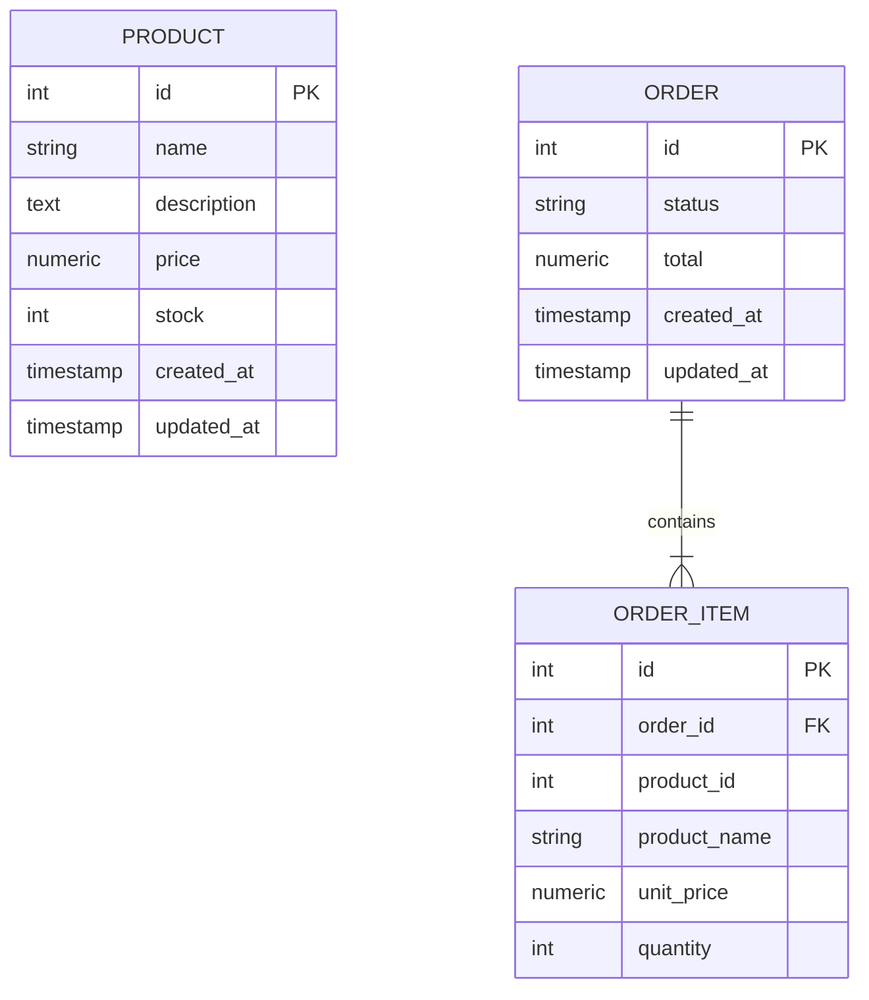
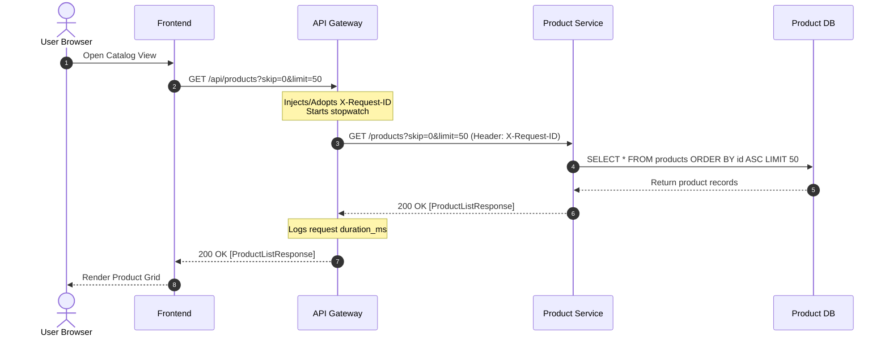
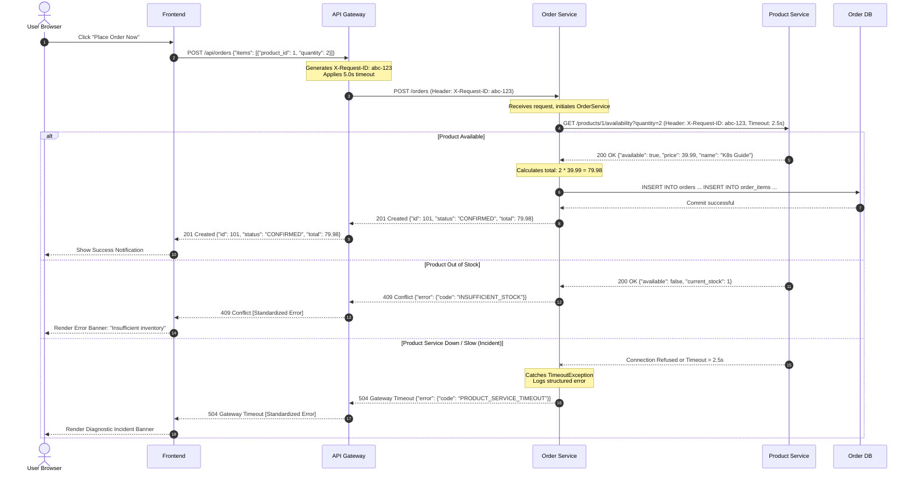
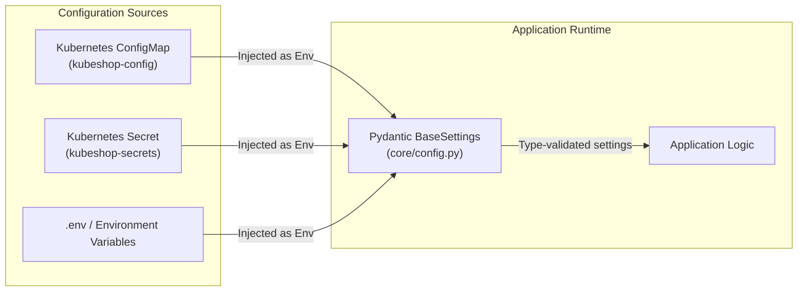

# KubeShop Architecture Specification

## 1. High-Level System Architecture

KubeShop is built as a set of autonomous, single-purpose microservices adhering to clean architectural boundaries, isolated persistence domains, and container-native operational patterns.

```mermaid
flowchart TD
    User([End User Browser])
    
    subgraph Frontend_Boundary ["Frontend Presentation Layer"]
        FE["Frontend (React 18 + TS + Nginx)<br/>Port: 3000"]
    end

    subgraph Gateway_Boundary ["Edge & Routing Layer"]
        GW["API Gateway (FastAPI)<br/>Port: 8000"]
    end

    subgraph Service_Boundary ["Core Domain Services"]
        PS["Product Service (FastAPI)<br/>Port: 8001"]
        OS["Order Service (FastAPI)<br/>Port: 8002"]
    end

    subgraph Persistence_Boundary ["Storage Layer (PostgreSQL)"]
        PDB[("kubeshop_product DB<br/>(Products Table)")]
        ODB[("kubeshop_order DB<br/>(Orders & OrderItems Tables)")]
    end

    User -->|HTTP / UI| FE
    FE -->|HTTP REST /api| GW
    GW -->|GET, POST /products| PS
    GW -->|GET, POST /orders| OS
    OS -->|HTTP GET /products/{id}/availability| PS
    PS -->|SQLAlchemy Async (DSN 1)| PDB
    OS -->|SQLAlchemy Async (DSN 2)| ODB
```

---

## 2. Service Responsibilities & Boundaries

| Component | In Scope | Out of Scope / Forbidden |
| :--- | :--- | :--- |
| **Frontend** | User UI, client state, rendering product catalog, cart management, error banners. | Connecting to database; making direct internal service calls bypassing the Gateway. |
| **API Gateway** | Unified external entry point; generating and propagating `X-Request-ID`; routing `/api/*`; standardizing JSON errors; enforcing timeouts (5s); structured access logging. | Database storage; domain business logic; total price calculation; order status management. |
| **Product Service** | Catalog metadata (name, description, price); stock inventory; availability validation; ownership of `products` table. | Accessing orders or customer records; approving orders; payment processing. |
| **Order Service** | Order lifecycle (CONFIRMED, PENDING, CANCELLED); price computation; line item snapshotting; ownership of `orders` and `order_items` tables. | Directly querying Product Service database tables; allowing clients to specify arbitrary prices. |
| **PostgreSQL** | Relational ACID storage. | Inter-service shared state (Product and Order tables reside in separate logical databases). |

---

## 3. Data Ownership & Schema Isolation

Data ownership is strictly partitioned by service boundary. Services communicate state changes exclusively via HTTP APIs, never by reading or writing to another service's database tables.



> [!IMPORTANT]
> `ORDER_ITEM` stores a **snapshot** (`product_name`, `unit_price`) captured at the moment of order placement. If a product's price or description changes in the catalog later, historical order records remain immutable.

---

## 4. End-to-End Request Flows

### Flow A: Product Catalog Browsing


### Flow B: Order Placement & Cross-Service Coordination


---

## 5. Configuration Flow & Environment Decoupling

Configuration follows the 12-Factor App methodology. No hostnames, ports, or credentials are hardcoded into application source code.



---

## 6. Failure Domains & Blast Radius Isolation

| Failure Event | Affected Components | Unaffected Components | Recovery Mechanism |
| :--- | :--- | :--- | :--- |
| **Product DB Crash** | Product Service `/ready` probe; Catalog browsing; New order placement. | Frontend remains online; Order Service process remains alive; Order history retrieval remains functional. | Kubernetes unroutes traffic from Product Service until DB reconnects. |
| **Product Service Crash** | Catalog browsing; New order placement. | Order history viewing; Frontend UI; Postgres database. | Kubernetes kubelet restarts Product Service container (livenessProbe). |
| **Order DB Crash** | Order Service `/ready` probe; Order placement; Order history. | Product catalog browsing remains 100% operational. | Kubernetes unroutes traffic from Order Service until DB reconnects. |
| **Gateway Crash** | External API ingress temporarily degraded. | Backend microservices and databases continue running normally. | Kubernetes rolls traffic to secondary Gateway replica. |
