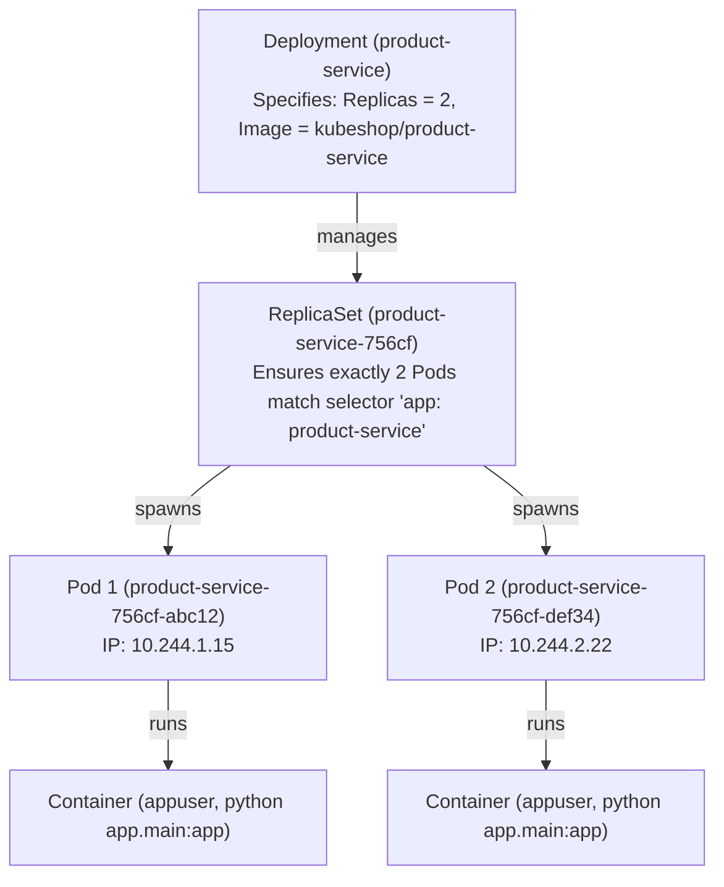

# Kubernetes Conceptual Architecture & Mapping Guide

## Purpose
This document bridges software architecture and cloud-native systems engineering. It maps each KubeShop application component directly to its corresponding Kubernetes resource primitive and explains **WHY** that Kubernetes object is necessary.

---

## 1. Application-to-Kubernetes Mapping Matrix

| KubeShop Concept | Kubernetes Object | Why This Object Exists in KubeShop | What Breaks Without It |
| :--- | :--- | :--- | :--- |
| **Cluster Partition** | `Namespace` (`kubeshop`) | Groups all KubeShop components together, isolating them from other cluster workloads. | Naming collisions with other apps; difficult bulk cleanup. |
| **Product Service Code** | `Deployment` (`product-service`) | Maintains 2 desired replicas, automates rolling updates, and self-heals crashed containers. | Pods would have to be manually started and restarted on crashes. |
| **Order Service Code** | `Deployment` (`order-service`) | Manages order placement instances independently from catalog instances. | Inability to scale order processing independently. |
| **API Gateway** | `Deployment` (`api-gateway`) | Horizontally scales ingress proxy instances to absorb client traffic bursts. | Single point of failure for all browser traffic. |
| **Frontend Web App** | `Deployment` (`frontend`) | Manages Nginx replicas serving static React assets. | Web interface unavailability. |
| **Database Process** | `Deployment` (`postgres`) | Ensures the PostgreSQL process is kept running on the cluster. | Database termination upon node restart. |
| **Service Discovery** | `Service` (`product-service`, `order-service`) | Provides stable internal DNS hostnames (`http://product-service:8000`) and L4 load balancing across Pod IPs. | Pod IP addresses change constantly; microservices would lose connectivity immediately on Pod restart. |
| **External Access** | `Service` (`NodePort`) & `Ingress` | Exposes HTTP routes outside the cluster so developer browsers can reach KubeShop. | Workloads remain completely inaccessible from outside the cluster network. |
| **Non-Sensitive Config** | `ConfigMap` (`kubeshop-config`) | Injects discovery URLs, timeouts, and log levels at runtime. | Configuration is locked into images, forcing container rebuilds for simple changes. |
| **Credentials & Passwords**| `Secret` (`kubeshop-secrets`) | Protects database passwords and DSN strings from plaintext Git exposure. | Security breach: passwords committed to version control. |
| **Database Persistence** | `PersistentVolumeClaim` (`postgres-pvc`) | Claims persistent physical/virtual disk volume for PostgreSQL storage. | All catalog products and customer orders wiped clean on container restart! |
| **Process Liveness** | `livenessProbe` (`/health`) | Detects whether the Python process has locked up or crashed; triggers restart. | Deadlocked processes hang indefinitely without self-healing. |
| **Traffic Readiness** | `readinessProbe` (`/ready`) | Verifies database connectivity. Unroutes traffic if DB fails without restarting Pod. | Users receive 500 errors from unready pods during transient outages. |
| **Resource Quotas** | `resources.requests` & `limits` | Slices CPU and memory; triggers throttling or OOMKilled when exceeded. | One misbehaving service starves the entire node of memory and CPU. |

---

## 2. The Deployment Hierarchy Explained

In Kubernetes, you never run bare Pods in production. KubeShop uses Deployments:



### Why not create Pods directly?
If a standalone Pod dies (e.g. process exits or host node fails), Kubernetes will **NOT** recreate it. Deployments delegate to ReplicaSets, which actively reconcile actual state against desired state. If you delete Pod 1, the ReplicaSet immediately schedules a replacement Pod 3.

---

## 3. How Kubernetes Service Discovery Works

When Order Service calls Product Service:
1. Order Service issues HTTP request to `http://product-service:8000/products/1/availability`.
2. The Pod's `/etc/resolv.conf` delegates to CoreDNS (`kube-dns`).
3. CoreDNS resolves `product-service` to the Service's virtual ClusterIP (e.g. `10.96.45.120`).
4. Kube-proxy / iptables intercepts the packet and routes it across healthy Pod IPs listed in the `Endpoints` object.
5. If Pod 1's `/ready` probe is failing, Kubernetes removes Pod 1 from `Endpoints`. Traffic is routed exclusively to healthy Pod 2!

---

## 4. Resource Sizing & Experimentation

In KubeShop, each microservice defines explicit requests and limits:

```yaml
resources:
  requests:
    cpu: 100m      # 0.1 CPU core guaranteed by the scheduler
    memory: 128Mi  # 128 Megabytes guaranteed
  limits:
    cpu: 300m      # Throttled by CFS quota if CPU usage exceeds 0.3 core
    memory: 256Mi  # Terminated with OOMKilled (Exit 137) if usage exceeds 256MB
```

This setup enables realistic experiments:
- **CPU Throttling**: Run `/dev/faults/cpu-burn` to watch request latency increase due to CPU limits.
- **OOMKilled**: Run `/dev/faults/memory-burn` to watch the Linux kernel kill the process when exceeding 256Mi.
