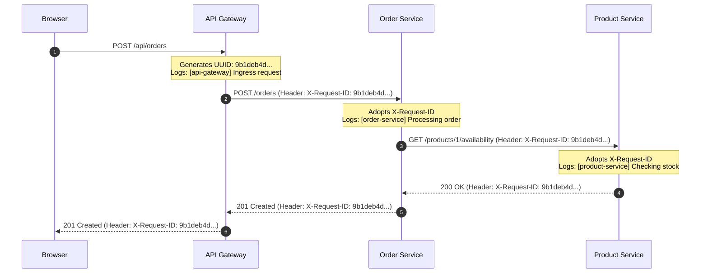

# KubeShop Observability & Incident Diagnostics Guide

## Purpose
This document establishes the observability standards implemented across KubeShop. It details structured JSON logging, distributed correlation tracking (`X-Request-ID`), health probe mechanics, and the telemetry evidence required for incident diagnosis and root-cause analysis (RCA).

---

## 1. Structured JSON Logging Specification

Every backend microservice (`api-gateway`, `product-service`, `order-service`) formats log records as single-line JSON objects to standard output (`stdout`). This allows log collectors (such as FluentBit, Promtail, Vector, or Datadog Agent) to parse log attributes without fragile regex parsing.

### Standard Log Schema
```json
{
  "timestamp": "2026-10-03T15:20:10.123456Z",
  "level": "INFO",
  "service": "order-service",
  "message": "Handled POST /orders -> 201",
  "logger": "order-service",
  "request_id": "9b1deb4d-3b7d-4bad-9bdd-2b0d7b3dcb6d",
  "method": "POST",
  "path": "/orders",
  "status_code": 201,
  "duration_ms": 34.52
}
```

### Dependency Failure Log Example
When an outbound call fails, the log entry enriches the record with dependency metadata:
```json
{
  "timestamp": "2026-10-03T15:22:45.981203Z",
  "level": "ERROR",
  "service": "order-service",
  "message": "Product Service timed out after 2.5s (elapsed: 2503.1ms)",
  "logger": "order-service",
  "request_id": "9b1deb4d-3b7d-4bad-9bdd-2b0d7b3dcb6d",
  "dependency": "product-service",
  "dependency_url": "http://product-service:8000/products/1/availability",
  "duration_ms": 2503.1,
  "error_type": "TimeoutException"
}
```

---

## 2. Distributed Tracing via `X-Request-ID`

To correlate a single end-to-end transaction across multiple distributed services:



### Investigating an Incident by Correlation ID:
An engineer (or automated AI diagnosis agent) can grep the correlation ID across all cluster logs:
```bash
# Search for all log entries related to a single failing transaction:
kubectl logs -l app.kubernetes.io/part-of=kubeshop-platform -n kubeshop | grep "9b1deb4d-3b7d-4bad-9bdd-2b0d7b3dcb6d"
```

---

## 3. Liveness vs. Readiness Probes

| Probe Type | Endpoint | Semantic Meaning | Action Taken When Probe Fails |
| :--- | :--- | :--- | :--- |
| **Liveness** (`livenessProbe`) | `/health` | "Is the application process alive and responsive?" | Kubelet **terminates and restarts** the container. |
| **Readiness** (`readinessProbe`)| `/ready` | "Can this Pod serve useful user traffic right now?" | Kubernetes **removes Pod from Service Endpoints** (stops sending traffic) without restarting the container. |

### Why This Separation Matters:
If PostgreSQL undergoes a brief 10-second failover:
- A naive health check that queries PostgreSQL would cause all microservice Pods to fail liveness probes simultaneously, triggering a massive cluster-wide container restart storm!
- By contrast, KubeShop's `/ready` probe flags the Pod as unready until the database returns, allowing existing connections to recover without container churn.

---

## 4. Answering Incident Evidence Questions

When a production incident occurs, KubeShop provides telemetry to answer the following questions:

| Question | Where to Find the Evidence |
| :--- | :--- |
| **What failed?** | Error code in HTTP response (`error.code`) and gateway access log. |
| **When did it fail?** | ISO 8601 `timestamp` in structured JSON logs. |
| **Which service first experienced the failure?** | Follow the `X-Request-ID` backwards through the log stream; the earliest `ERROR` log pinpoints the root service. |
| **Was the process alive?** | `kubectl get pods -n kubeshop` (look for `Running` status vs `CrashLoopBackOff`). |
| **Was the Pod ready?** | `kubectl get endpoints -n kubeshop` (look for absent Pod IPs). |
| **Did Kubernetes restart anything?** | `RESTARTS` column in `kubectl get pods -n kubeshop`. |
| **Was another service responsible?** | Inspect `dependency` and `dependency_url` fields in the caller's log entry. |
| **Was the database reachable?** | Inspect `/ready` response and `DATABASE_UNAVAILABLE` error logs. |
| **Was the failure caused by configuration?** | `CrashLoopBackOff` events and `KeyError` / `ValidationError` logs during startup. |
| **Was the service timing out?** | Log records with `error_type: "TimeoutException"` and `duration_ms > timeout`. |
