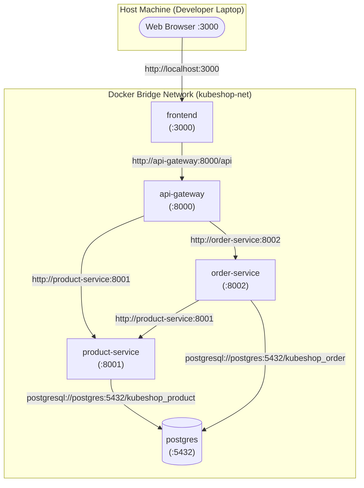

# KubeShop Docker & Compose Environment

## Purpose
This directory contains the multi-container **Docker Compose** environment for KubeShop. It allows running and verifying the entire microservice ecosystem locally with full networking, configuration injection, and database isolation before deploying to Kubernetes.

---

## Docker Architecture

```
Application Source Code
          ↓
     Dockerfile
          ↓
     Docker Image
          ↓
   Running Container
```

Each backend service (`product-service`, `order-service`, `api-gateway`) uses a lightweight `python:3.11-slim` base image and runs as a non-privileged `appuser`. The `frontend` uses a multi-stage Docker build: Node.js compiles the TypeScript SPA, and an Alpine Nginx server serves the static assets while reverse-proxying `/api/` traffic.

---

## Docker Compose Topology



---

## Why Service Names Instead of `localhost`?
Within a Docker Compose environment, each container runs inside its own isolated network namespace.
- In container A, `localhost` refers **only to container A itself**.
- To allow container-to-container communication, Docker creates an internal DNS server for the bridge network (`kubeshop-net`).
- Container hostnames resolve automatically to container IP addresses using their Compose service names:
  - `http://product-service:8001`
  - `http://order-service:8002`
  - `http://api-gateway:8000`
  - `postgres:5432`

This prepares the application directly for Kubernetes, where Kubernetes CoreDNS provides the exact same service discovery abstraction.

---

## Port Mappings
| Service | Internal Port | Host Port | Purpose |
| :--- | :--- | :--- | :--- |
| `frontend` | `3000` | `3000` | Web UI (React + Nginx) |
| `api-gateway` | `8000` | `8000` | API Gateway REST Entry Point |
| `product-service` | `8001` | `8001` | Catalog & Inventory REST API |
| `order-service` | `8002` | `8002` | Order Processing REST API |
| `postgres` | `5432` | `5432` | PostgreSQL Database Server |

---

## Quickstart Guide

### 1. Start the Complete Stack
From the repository root:
```bash
docker compose -f infrastructure/docker/docker-compose.yml up --build -d
```

### 2. View Service Logs
```bash
# Follow logs from all services
docker compose -f infrastructure/docker/docker-compose.yml logs -f

# Follow logs from a specific service
docker compose -f infrastructure/docker/docker-compose.yml logs -f product-service
```

### 3. Verify Health Probes
```bash
curl http://localhost:8000/health  # API Gateway Liveness
curl http://localhost:8001/health  # Product Service Liveness
curl http://localhost:8002/health  # Order Service Liveness

curl http://localhost:8000/ready   # Gateway Readiness
curl http://localhost:8001/ready   # Product Service Readiness (checks DB)
curl http://localhost:8002/ready   # Order Service Readiness (checks DB)
```

### 4. Open the Web Interface
Navigate your browser to:
```
http://localhost:3000
```

### 5. Stop the Stack
```bash
docker compose -f infrastructure/docker/docker-compose.yml down
# To remove persistent database volume as well:
docker compose -f infrastructure/docker/docker-compose.yml down -v
```
