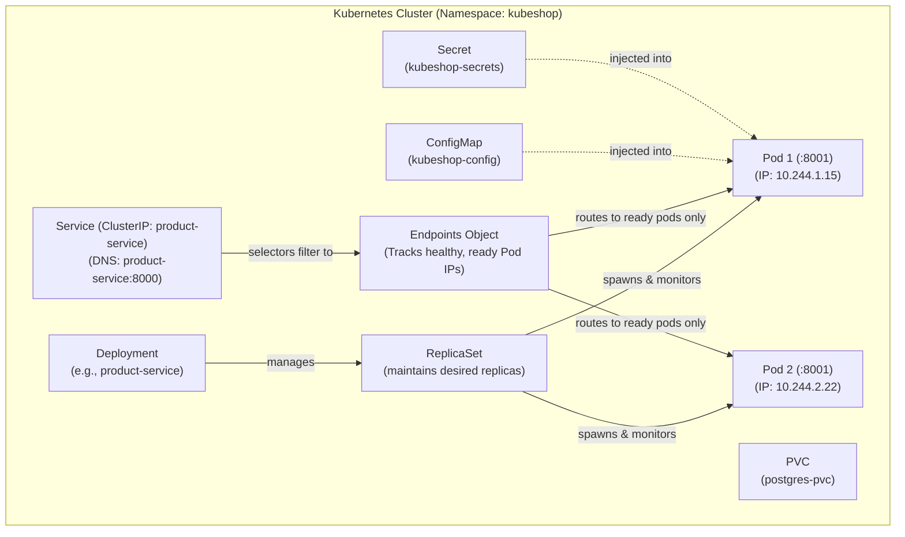

# KubeShop Kubernetes Architecture & Manifest Guide

## Purpose
This directory contains plain, commented, and educational Kubernetes manifests for deploying KubeShop. It deliberately avoids hiding concepts behind Helm charts or complex abstractions so learners can understand each native Kubernetes API primitive.

---

## The Cloud-Native Hierarchy



---

## Directory & Manifest Catalog

```
infrastructure/kubernetes/
├── README.md                          # This architecture guide
├── namespace.yaml                     # Logical partition (kubeshop)
├── config/
│   ├── configmap.yaml                 # Non-sensitive URLs and runtime configs
│   └── secret.yaml                    # Base64-encoded development credentials
├── storage/
│   └── postgres-pvc.yaml              # PersistentVolumeClaim for database state
├── database/
│   ├── postgres-init-configmap.yaml   # SQL initialization script for multi-tenancy
│   ├── postgres-deployment.yaml       # PostgreSQL Pod Deployment
│   └── postgres-service.yaml          # ClusterIP service (postgres-service:5432)
├── product-service/
│   ├── deployment.yaml                # 2 Replicas, probes, resource requests/limits
│   └── service.yaml                   # ClusterIP service (product-service:8000)
├── order-service/
│   ├── deployment.yaml                # 2 Replicas, probes, dependency URL injection
│   └── service.yaml                   # ClusterIP service (order-service:8000)
├── gateway/
│   ├── deployment.yaml                # 2 Replicas, CORS, reverse-proxy config
│   └── service.yaml                   # NodePort service (NodePort: 30080)
├── frontend/
│   ├── deployment.yaml                # 2 Replicas, React static SPA + Nginx
│   └── service.yaml                   # NodePort service (NodePort: 30000)
└── ingress/
    └── ingress.yaml                   # Host-based routing for kubeshop.local
```

---

## Manifest-by-Manifest Learning Guide

### 1. `namespace.yaml`
- **WHAT it creates**: The `kubeshop` Namespace.
- **WHY it exists**: Provides multi-tenancy and resource boundary isolation inside the cluster.
- **CONCEPT**: Logical cluster partitioning.
- **DEPENDENTS**: All other manifests reside inside `namespace: kubeshop`.

### 2. `config/configmap.yaml`
- **WHAT it creates**: `ConfigMap/kubeshop-config`.
- **WHY it exists**: Injects URLs (`PRODUCT_SERVICE_URL`, `ORDER_SERVICE_URL`) and timeouts (`GATEWAY_REQUEST_TIMEOUT_SECONDS`) into pods at runtime without rebuilding images.
- **CONCEPT**: Decoupling configuration from container artifacts (12-Factor App).
- **DEPENDENTS**: `product-service`, `order-service`, and `api-gateway` Deployments.

### 3. `config/secret.yaml`
- **WHAT it creates**: `Secret/kubeshop-secrets`.
- **WHY it exists**: Separates confidential connection strings (`PRODUCT_DATABASE_URL`, `ORDER_DATABASE_URL`) from public configuration.
- **CONCEPT**: Encrypted/RBAC-protected credential storage.
- **DEPENDENTS**: PostgreSQL, Product Service, and Order Service.

### 4. `storage/postgres-pvc.yaml`
- **WHAT it creates**: `PersistentVolumeClaim/postgres-pvc` (1Gi).
- **WHY it exists**: Container filesystems are ephemeral. If a Postgres Pod crashes or is restarted, all database data would be destroyed without a PVC.
- **CONCEPT**: Decoupling data lifecycle from compute pod lifecycle.
- **DEPENDENTS**: `postgres-deployment.yaml`.

### 5. `database/postgres-deployment.yaml` & `postgres-service.yaml`
- **WHAT it creates**: Single-replica Deployment for PostgreSQL 16 and a ClusterIP Service named `postgres-service`.
- **WHY it exists**: Hosts the relational databases for catalog and order storage.
- **CONCEPT**: Stateful workload deployment and internal DNS abstraction (`postgres-service:5432`).
- **DEPENDENTS**: Product Service and Order Service.

### 6. `product-service/deployment.yaml` & `service.yaml`
- **WHAT it creates**: 2-replica Deployment and `product-service:8000` ClusterIP Service.
- **WHY it exists**: Manages catalog and inventory availability.
- **CONCEPTS**:
  - `replicas: 2`: Horizontal scaling and high availability.
  - `readinessProbe` (`/ready`): Executes `SELECT 1` on the DB. If Postgres fails, the Pod is removed from Service Endpoints so callers receive no broken responses.
  - `livenessProbe` (`/health`): Checks whether the Python process is alive. If deadlocked, kubelet restarts the container.
  - `resources.requests` & `resources.limits`: Enforces CPU and memory consumption boundaries.
- **DEPENDENTS**: Order Service and API Gateway.

### 7. `order-service/deployment.yaml` & `service.yaml`
- **WHAT it creates**: 2-replica Deployment and `order-service:8000` ClusterIP Service.
- **WHY it exists**: Orchestrates checkout and order persistence.
- **CONCEPTS**: Demonstrates downstream service dependency chains (`order-service` -> `product-service`).
- **DEPENDENTS**: API Gateway.

### 8. `gateway/deployment.yaml` & `service.yaml`
- **WHAT it creates**: 2-replica Deployment and `api-gateway:8000` NodePort Service (NodePort: 30080).
- **WHY it exists**: Single point of ingress routing, request correlation (`X-Request-ID`), and timeout enforcement.
- **DEPENDENTS**: Frontend Nginx reverse proxy and external callers.

### 9. `frontend/deployment.yaml` & `service.yaml`
- **WHAT it creates**: 2-replica Deployment and `frontend:3000` NodePort Service (NodePort: 30000).
- **WHY it exists**: Serves the user interface and proxies API traffic to `api-gateway`.
- **DEPENDENTS**: End-user web browsers.

### 10. `ingress/ingress.yaml`
- **WHAT it creates**: Kubernetes Ingress mapping `kubeshop.local` to Frontend and Gateway services.
- **WHY it exists**: Single host-based entry point eliminating the need for arbitrary NodePort numbers in production.

---

## Step-by-Step Deployment Progression

To observe resources being created incrementally, apply manifests in this exact order:

```bash
# 1. Create Namespace
kubectl apply -f infrastructure/kubernetes/namespace.yaml

# 2. Apply ConfigMap and Secret
kubectl apply -f infrastructure/kubernetes/config/

# 3. Create Storage Claim
kubectl apply -f infrastructure/kubernetes/storage/

# 4. Deploy Database & Service
kubectl apply -f infrastructure/kubernetes/database/
# Wait for database to report Ready:
kubectl wait --for=condition=ready pod -l app=postgres -n kubeshop --timeout=60s

# 5. Deploy Product Service
kubectl apply -f infrastructure/kubernetes/product-service/
kubectl wait --for=condition=ready pod -l app=product-service -n kubeshop --timeout=60s

# 6. Deploy Order Service
kubectl apply -f infrastructure/kubernetes/order-service/
kubectl wait --for=condition=ready pod -l app=order-service -n kubeshop --timeout=60s

# 7. Deploy API Gateway
kubectl apply -f infrastructure/kubernetes/gateway/
kubectl wait --for=condition=ready pod -l app=api-gateway -n kubeshop --timeout=60s

# 8. Deploy Frontend
kubectl apply -f infrastructure/kubernetes/frontend/
kubectl wait --for=condition=ready pod -l app=frontend -n kubeshop --timeout=60s

# 9. Verify Complete Cluster State
kubectl get all -n kubeshop
```

---

## Inspection & Debugging Cheatsheet

```bash
# Check Pod status and restart counts
kubectl get pods -n kubeshop -o wide

# Inspect Pod lifecycle events, probe failures, and image pull state
kubectl describe pod <pod-name> -n kubeshop

# View real-time JSON logs across all replicas of a service
kubectl logs -l app=product-service -n kubeshop -f

# View logs from a previously crashed container
kubectl logs <pod-name> -n kubeshop --previous

# Check active service endpoints (only healthy/ready Pods appear here!)
kubectl get endpoints -n kubeshop
```
